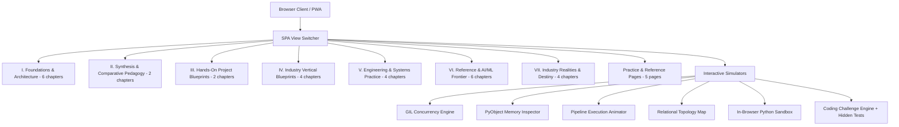

# PyCSharp – Technical Architecture Specification

## 1. System Vision & Architecture

**PyCSharp** is a single-page polyglot systems application engineered with modern React 19, TypeScript, Vite, and Tailwind CSS v4. The platform serves as a technical bridge, mapping high-performance Microsoft .NET (C#) concepts into Python systems internals.

28 numbered curriculum chapters (7 groups above) plus 5 standalone practice/reference pages
(Home, Coding Challenges, Infographics, Learn Python Like a Language, Python as Art) — 33 views
total. The authoritative, always-current list is [`docs/MODULES_CATALOG.md`](MODULES_CATALOG.md),
generated directly from `src/views/` and verified for staleness in CI.

**App shell**: the root layout (`App.tsx`) is height-constrained to the viewport
(`h-screen overflow-hidden`), with the header and sidebar as non-scrolling siblings of a single
internally-scrolling `<main>` region — not, as in earlier revisions, a page that scrolled as one
long document. Chapter-navigation "scroll to top" calls target that `<main>` element directly
(`mainContentRef.current.scrollTo(...)`) rather than `window.scrollTo`, since the window itself
no longer scrolls. The "Overall Course Progress" indicator lives inside `<main>` as a
`position: sticky` bar pinned to the top of that scrolling region, visible regardless of how far
the user has scrolled into a chapter.

## 2. Directory Structure & Modular Separation

- `/src/views/`: 33 modular views (28 numbered curriculum chapters + 5 practice/reference pages).
- `/src/components/`: Reusable, interactive visualizers, simulation canvases, navigation bars, modals, and search components.
- `/src/data/`: Structured TypeScript datasets containing curriculum schemas, code comparisons, questions, and benchmark metrics.
- `/src/services/`: Client-side persistence, background synchronization, and offline storage managers.
- `/public/`: Static assets, PWA manifests, service workers, and RFC 9116 security declarations.
- `/scripts/`: Automated documentation generator scripts.
- `/docs/`: Master prompt book, architecture specifications, and module catalogs.

## 3. Interactive Engines & Simulators

### A. GIL Concurrency Simulator (`GilConcurrencyVisualizer.tsx`)

Simulates multi-threaded CPU-bound contention under CPython's Global Interpreter Lock:

- Mutex token handoff loop based on the 5ms check interval (`sys.getswitchinterval()`).
- Real-time CPU core load visualization across 4 logical cores, demonstrating how 1 core hits 100% saturation while remaining cores stay idle during pure Python CPU-bound workloads.
- Interactive controls: Run/Pause, step rate adjustments, and precision zoom controls (75% to 150%).

### B. Memory PyObject Inspector (`MemoryPyObjectVisualizer.tsx`)

Exposes CPython's C struct memory layout:

- `ob_refcnt`: 64-bit reference counter incremented on variable assignment/aliasing and decremented on `del`.
- `ob_type`: Pointer to the object type descriptor (`PyTypeObject`).
- `PyGC_Head`: Double-linked list pointers for cyclic garbage collection detection (Generations 0, 1, and 2).
- Dynamic cycle creation (`a.cycle = a`) triggering generation cycle collection algorithms.
- Interactive zoom in, zoom out, percentage readout, and state resets.

### C. Relational Mindmap Visualizer (`MindmapVisualizer.tsx`)

Interactive visual node topology mapping .NET paradigms to Python equivalents across 9 domain
clusters (27 leaf concept nodes total): Types & Memory, Collections & LINQ, Flow & Errors, OOP &
Protocols, Async & Concurrency, Tooling & Ecosystem, Functions, Testing & QA, and Web/Data/AI.

The radial canvas is a fixed 1050×720 virtual coordinate space, scaled at render time to exactly
fill its container (measured via `ResizeObserver`, applied as a CSS `transform: scale()`) so the
entire graph is always visible in one view with no scrollbar, at any viewport size. The existing
zoom (0.7×–1.5×) and pan controls multiply on top of that auto-fit baseline rather than replacing
it — "100%" means "fit to view," not "native pixel size."

## 4. Security & Compliance

- **Content Security Policy**: Restricts scripts, connections, frames, object plugins, and browser capabilities to the same origin. Fonts are bundled or loaded only by explicit application markup.
- **HTTP Strict Transport Security (HSTS)**: 2-year duration with subdomains and preload enabled.
- **RFC 9116**: Security contact declared at `/.well-known/security.txt`.
- **PWA Capabilities**: Service Worker precaches core static resources and employs Stale-While-Revalidate caching for resilient offline functionality. API requests are never cached.
- **Quality Gates**: Vitest/V8 enforces 100% statement, branch, function, and line coverage for the persistence service. UI, service-worker, and Vite middleware behavior require browser or integration coverage before being included in a whole-application threshold.

### Runtime Security Boundary

The Interactive Sandbox executes learner-submitted Python entirely client-side via **Pyodide** (CPython compiled to WebAssembly), running inside a dedicated Web Worker (`src/workers/pyodideWorker.ts`), orchestrated by `src/services/pyodideSandboxService.ts`. There is no server-side code execution endpoint at all — code never leaves the browser.

This design satisfies the sandbox's security requirements structurally rather than by policy:

- **No host filesystem, server secrets, or internal services are reachable** — the Worker has no access to them; it isn't a server process at all.
- **No arbitrary network access from executed code** — Pyodide's WASI-based environment has no real sockets; the page's own CSP (`connect-src 'self' ...`) further restricts what the origin itself can reach.
- **No other users' data is reachable** — execution is entirely local to the visitor's own browser tab.
- **Resource limits**: a 10-second wall-clock timeout is enforced by the main thread calling `Worker.terminate()` — the only reliable way to stop a synchronous infinite loop, since Pyodide has no cooperative interrupt for one. Output is capped at 20,000 characters per stream.
- **Runtime files are self-hosted** (`public/pyodide/`, vendored by `scripts/copy-pyodide-runtime.mjs`), not loaded from a third-party CDN, keeping the site's strict same-origin CSP intact.

The formerly-present `/api/execute-python` dev-server endpoint (which spawned a real Python subprocess) has been removed entirely — it was gated behind an opt-in environment variable but represented exactly the "execute untrusted code in the application's own process" anti-pattern this design now avoids structurally.

---
**Repository:** [GitLab repository](https://gitlab.com/adityarachuri/pycsharplearningguide)
