# PyCSharp – Technical Architecture Specification

## 1. System Vision & Architecture

**PyCSharp** is a single-page polyglot systems application engineered with modern React 19, TypeScript, Vite, and Tailwind CSS v4. The platform serves as a technical bridge, mapping high-performance Microsoft .NET (C#) concepts into Python systems internals.

```mermaid
graph TD
    Client[Browser Client / PWA] --> Routing[SPA View Switcher]
    Routing --> Mod1[Foundations & History]
    Routing --> Mod2[CPython vs CLR Internals]
    Routing --> Mod3[10 Core Deep Dives]
    Routing --> Mod4[Batteries Included]
    Routing --> Mod5[DSA & Algorithms]
    Routing --> Mod6[Workstation Toolchain]
    Routing --> Mod7[Rosetta Stone Matrix]
    Routing --> Mod8[Advanced Metaprogramming]
    Routing --> Mod9[Real-World Use Cases]
    Routing --> Mod10[Glossary & Disambiguation]
    Routing --> Mod11[AI/ML PyTorch & NumPy]
    Routing --> Mod12[Transition Playbook]
    Routing --> Mod13[Researchers & Citations]
    Routing --> Mod14[Future Python 3.13 / PEP 703]
    Routing --> Mod15[Career & Leadership]
    Routing --> Mod16[Conclusion & Certification]

    Routing --> Simulators[Interactive Simulators]
    Simulators --> GIL[GIL Concurrency Engine]
    Simulators --> Mem[PyObject Memory Inspector]
    Simulators --> AST[Pipeline Execution Animator]
    Simulators --> Mindmap[Relational Topology Map]
    Simulators --> REPL[In-Browser Python Sandbox]
```

## 2. Directory Structure & Modular Separation

- `/src/views/`: 18 modular curriculum views.
- `/src/components/`: Reusable, interactive visualizers, simulation canvases, navigation bars, modals, and search components.
- `/src/data/`: Structured TypeScript datasets containing curriculum schemas, code comparisons, questions, and benchmark metrics.
- `/src/services/`: Client-side persistence, background synchronization, and offline storage managers.
- `/public/`: Static assets, PWA manifests, service workers, and RFC 9116 security declarations.
- `/scripts/`: Automated documentation generator scripts.
- `/docs/`: Master prompt book, architecture specifications, and module catalogs.

## 3. Interactive Engines & Simulators

### A. GIL Concurrency Simulator (`GilConcurrencyVisualizer.tsx`)

Simulates multi-threaded CPU-bound contention under CPython's Global Interpreter Lock:

- Mutex token handoff loop based on the 5ms check interval (`sys.getswitchinterval()`).
- Real-time CPU core load visualization across 4 logical cores, demonstrating how 1 core hits 100% saturation while remaining cores stay idle during pure Python CPU-bound workloads.
- Interactive controls: Run/Pause, step rate adjustments, and precision zoom controls (75% to 150%).

### B. Memory PyObject Inspector (`MemoryPyObjectVisualizer.tsx`)

Exposes CPython's C struct memory layout:

- `ob_refcnt`: 64-bit reference counter incremented on variable assignment/aliasing and decremented on `del`.
- `ob_type`: Pointer to the object type descriptor (`PyTypeObject`).
- `PyGC_Head`: Double-linked list pointers for cyclic garbage collection detection (Generations 0, 1, and 2).
- Dynamic cycle creation (`a.cycle = a`) triggering generation cycle collection algorithms.
- Interactive zoom in, zoom out, percentage readout, and state resets.

### C. Relational Mindmap Visualizer (`MindmapVisualizer.tsx`)

Interactive visual node topology mapping .NET paradigms to Python equivalents across 6 clusters:

1. Syntax & Typing (`var` / `dynamic` vs Duck Typing, Type Hints)
2. Object Orientation (`class`, `interface` vs Protocol, Abstract Base Classes)
3. Memory & GC (`Dispose` / `using` vs `with`, Reference Counting)
4. Concurrency (`Task` / `async` vs `asyncio`, ThreadPool vs `ProcessPoolExecutor`)
5. Data Manipulation (LINQ vs List Comprehensions, Generators)
6. Ecosystem (`NuGet` / `csproj` vs `uv` / `pyproject.toml`)

## 4. Security & Compliance

- **Content Security Policy**: Restricts scripts, connections, frames, object plugins, and browser capabilities to the same origin. Fonts are bundled or loaded only by explicit application markup.
- **HTTP Strict Transport Security (HSTS)**: 2-year duration with subdomains and preload enabled.
- **RFC 9116**: Verified security contact declared at `/.well-known/security.txt` pointing to `mailto:adityarachuri@outlook.com`.
- **PWA Capabilities**: Service Worker precaches core static resources and employs Stale-While-Revalidate caching for resilient offline functionality. API requests are never cached.
- **Quality Gates**: Vitest/V8 enforces 100% statement, branch, function, and line coverage for the persistence service. UI, service-worker, and Vite middleware behavior require browser or integration coverage before being included in a whole-application threshold.

### Runtime Security Boundary

The optional `/api/execute-python` development endpoint is disabled unless `ENABLE_PYTHON_EXECUTION=true`. It is not a security sandbox: it must run only on loopback or behind a separately isolated, authenticated execution service with OS/container restrictions, resource quotas, and network policy.

---
**Maintained by:** [Aditya Rachuri](mailto:adityarachuri@outlook.com)

**Repository:** [GitLab repository](https://gitlab.com/adityarachuri/pycsharp)
